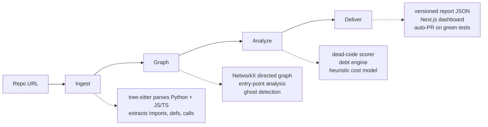

# GhostCode

Turns dead code into a P&L statement. Point it at a GitHub repo and get
a dependency graph, a dead-code report with real dollar numbers, and
safe auto-generated PRs that delete the dead files.



Four layers, one pipeline:

1. **Ingest** (`backend/ingest/`): tree-sitter parses every Python and
   JS/TS file into symbol records (imports, definitions, calls).
   Handles src-layouts, `@/` aliases, dynamic imports, JSX, decorators.
2. **Graph** (`backend/ingest/graph.py`): a NetworkX directed graph of
   files and symbols. Entry-point analysis (tests, `__main__` guards,
   framework conventions) separates real entry points from ghosts.
3. **Analyze** (`backend/engines/`): the dead-code scorer (LOW/MED/HIGH
   risk with reasons), the debt engine (circular imports, duplicates,
   huge files), and the cost model (LOC x $0.50 x complexity, all
   parameters externalized and recorded in the report).
4. **Deliver**: a FastAPI backend (`POST /analyze`, polling, `POST /pr`
   for auto-PRs gated on sandboxed test runs) and a Next.js dashboard
   (report, graph view, file table, PR preview).

## Quickstart (under 5 minutes)

```bash
# 1. Clone and set up the backend
git clone https://github.com/abdullah129026/ghostcode
cd ghostcode/backend
python -m venv .venv && source .venv/bin/activate
pip install -r requirements.txt

# 2. Analyze a repo (prints the versioned report JSON)
python -m ingest.cli --report /path/to/your/repo

# 3. Or run the API
uvicorn api.app:create_app --factory --port 8000
# POST /analyze {"repo_url": "https://github.com/you/your-repo"}

# 4. Dashboard (needs NEXT_PUBLIC_API_URL pointing at the API)
cd ../frontend
npm install && npm run dev
```

Docker and Render/Vercel configs are in the repo (`backend/Dockerfile`,
`render.yaml`, `frontend/vercel.json`). The backend runs fine on
Render's free tier; cold starts are expected.

## What it does not do (v1 scope)

- Python and JavaScript/TypeScript only.
- Public GitHub repos only (no private-repo OAuth).
- No incremental analysis, no IDE plugins, no monorepo-aware analysis.
- Auto-PR deletes whole files, and only LOW-risk ones, and only after
  your test suite passes in a sandbox. Symbols are never auto-deleted.

See `CASE_STUDY.md` for the dogfood run (including the thirteen
false-positive classes found by running GhostCode on itself) and
`docs/adr/` for the architecture decisions.

## Resume bullets

- Built a static-analysis pipeline (tree-sitter, NetworkX) that finds
  dead code in Python/JS/TS repos and prices it with a heuristic cost
  model; shipped as a FastAPI backend and Next.js dashboard.
- Cut false-positive ghost flags from 89% to ~1% by dogfooding on real
  repos; every fix covered by regression tests (137 backend tests).
- Designed a sandboxed auto-PR flow (subprocess isolation, rlimits,
  dependency install inside the sandbox) that opens deletion PRs only
  on green test runs.

## License

MIT. See `LICENSE`.
